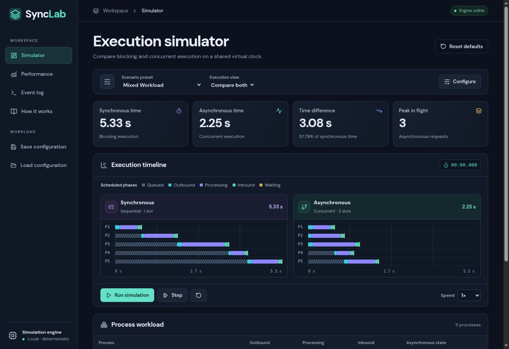

# SyncLab — Interactive Synchronous and Asynchronous Execution Simulator

SyncLab is a local-first systems lab for comparing two execution models against identical process inputs. The dashboard shows where time goes, which request finishes first, and how each client learns that a response is available.



## Problem statement

“Develop a project comparing synchronous and asynchronous execution using simulated processes, communication delays, and response mechanisms.”

## Abstract and objectives

The TypeScript engine computes a deterministic schedule in virtual milliseconds. React replays that schedule and provides a process inspector, filtered event log and comparative charts. Students can isolate the effect of latency, concurrency, delivery policy and failure recovery while holding the underlying work constant.

- Trace blocking and non-blocking request lifecycles.
- Explain a change in completion order using timestamps and overlapping intervals.
- Distinguish client waiting, network transmission and simulated processing.
- Measure successful throughput and terminal outcomes alongside elapsed time.

## Install and run

Use Node.js 22.12 or later and npm. Extract the ZIP, open the **SyncLab** folder containing package.json in Antigravity or VS Code, then open its terminal.

```sh
npm install
npm run dev
```

Open the local URL printed by Vite, normally http://localhost:5173. Use Ctrl+C to stop the server. The application runs entirely in the browser. The first install needs package-registry access. No accounts, environment variables, database or API keys are required.

```sh
npm run test
npm run build
npm run preview
```

The build runs strict TypeScript checking and emits a static site in dist. The preview command serves that build, normally at http://localhost:4173. For an exact lockfile install on a fresh checkout, use npm ci.

## Use the lab

1. Start with **Mixed Workload** and compare the two Gantt lanes. The full schedule and comparison totals are available before playback. Both lanes use the same time scale.
2. Use **Configure** to change the process count, names, arrival times, transport delays, processing times, failure behavior or delivery policy. Apply validates the entire draft and starts a fresh playback.
3. **Run simulation**, pause, resume, or step through the next distinct virtual timestamp. Adjust playback speed without changing the computed results. The circular arrow rewinds playback. **Reset defaults** also restores the default inputs.
4. Select a process in either lane to inspect that model's lifecycle and response state. In **Event log**, filter the events reached so far. The JSON export contains the complete schedules for both models.
5. Open **Performance** for makespan, per-process response time, cumulative terminal counts, metric definitions and CSV export.
6. Save one configuration in the current browser and reload it later. Saving again replaces that slot. Invalid or unsupported saved data produces a readable error.
7. In **How it works**, measure three actual browser timers with sequential await and Promise.all. Those results are real elapsed times.

## Features and technology

| Area          | Implementation                                                                                                |
| ------------- | ------------------------------------------------------------------------------------------------------------- |
| Workload      | 1–20 processes, bulk count, add, edit, duplicate, delete, six presets                                         |
| Scheduling    | Shared deterministic engine, stable tie handling, positive-duration in-flight limit                           |
| Reliability   | Per-attempt deadlines, failures on first or every attempt, bounded retries and backoff, late-response discard |
| Visualization | Scaled Gantt lanes, live states, selectable lifecycles, three Recharts visualizations                         |
| Interface     | React, TypeScript, Vite, Tailwind CSS, Lucide React, Motion and bundled DM Sans                               |
| Verification  | Vitest, React Testing Library and Playwright browser flow                                                     |
| Data          | Versioned localStorage configuration, CSV terminal records and JSON event traces                              |

## Architecture and algorithm

The workload editor produces a validated configuration. Each scheduler admits eligible attempts using available slot times, computes delivery or timeout, records intervals, and schedules any retry. The resulting event arrays are ordered by virtual timestamp and deterministic sequence. Playback moves a cursor over the schedule. Analytics uses terminal records and attempt occupancy. The architecture diagram and data contracts are in [Architecture](docs/ARCHITECTURE.md).

| Response policy | Client behavior                                                                         |
| --------------- | --------------------------------------------------------------------------------------- |
| Direct          | Caller awaits its reply. In async mode other independent callers can occupy free slots. |
| Callback        | Registers a completion handler at dispatch and invokes it when the reply is delivered.  |
| Polling         | Checks on dispatch-relative ticks. Detection waits until the first eligible poll.       |
| Event queue     | Enqueues a ready response, then delivers after the configured queue delay.              |

Under equal overhead, callbacks and direct delivery can have identical timestamps. Their registration and notification events differ. The queue uses a fixed delivery delay with independent notices. See [Algorithms](docs/ALGORITHMS.md) for formulas, deadline ties, ordering and retry semantics.

## Example results

The engine produced the following values for the bundled Mixed Workload, three asynchronous slots, callback delivery and zero response overhead.

| Statistic                       | Synchronous | Asynchronous |
| ------------------------------- | ----------: | -----------: |
| Workload finish                 |    5,330 ms |     2,250 ms |
| Mean response                   |    3,204 ms |     1,464 ms |
| Mean waiting                    |    2,138 ms |       398 ms |
| Communication across attempts   |    1,180 ms |     1,180 ms |
| Successful throughput           |     0.938/s |      2.222/s |
| Peak in flight                  |           1 |            3 |
| Successful / failed / timed out |   5 / 0 / 0 |    5 / 0 / 0 |

P4 starts at 840 ms in the async schedule and finishes at 1,440 ms, ahead of P3 at 1,640 ms. The workload saves 3,080 virtual ms in this configuration. Choosing a single success-only process removes that advantage.

## Assumptions and limits

The virtual clock starts at zero and includes idle time before the first arrival. Process durations are fixed. Independent servers have enough capacity to overlap processing. CPU contention, bandwidth sharing and dependent requests are outside the model. Peak concurrency counts positive-length overlaps. A zero-duration workload has undefined throughput. Terminal metrics exclude late observations after the last logical result. Browser storage belongs to the current origin.

## Screenshots

- [Simulator and timelines](docs/screenshots/dashboard.jpg)
- [Performance metrics on an edited polling workload](docs/screenshots/performance.jpg)
- [390 px mobile viewport](docs/screenshots/mobile.jpg)

## Tests and browser checks

```sh
npm run test
npm run build
npx playwright install chromium
npm run test:e2e
```

The standalone browser flow serves the production build on an available local port. [Testing](docs/TESTING.md) records the results and the separate managed-browser checks.

## Repository and deployment

| Folder            | Contents                                                           |
| ----------------- | ------------------------------------------------------------------ |
| src/engine        | Event types, scheduling, performance accounting                    |
| src/data          | Presets, input validation, save decoding                           |
| src/hooks         | Playback clock and indexed lifecycle lookup                        |
| src/components    | Configuration, timeline, inspector, learning and analytics         |
| src/tests         | Engine, configuration, editor and playback tests                   |
| e2e               | Download, editing, playback and responsive browser checks          |
| public            | Local brand asset                                                  |
| docs              | Architecture, algorithms, report, viva preparation and screenshots |
| .github/workflows | Optional manually triggered GitHub Pages workflow                  |

To deploy to your own repository, enable Pages with **GitHub Actions** as the source and manually run **Deploy SyncLab to GitHub Pages**. Relative asset paths and hash navigation support repository subpaths. The package includes no Git remote.

## Academic materials and future work

[Project overview](docs/PROJECT_OVERVIEW.md) · [Academic report](docs/PROJECT_REPORT.md) · [Viva questions](docs/VIVA_QUESTIONS.md)

A next experiment could add a finite pool of server workers, dependency graphs or seeded jitter. Each extension would require new fairness and determinism tests.
