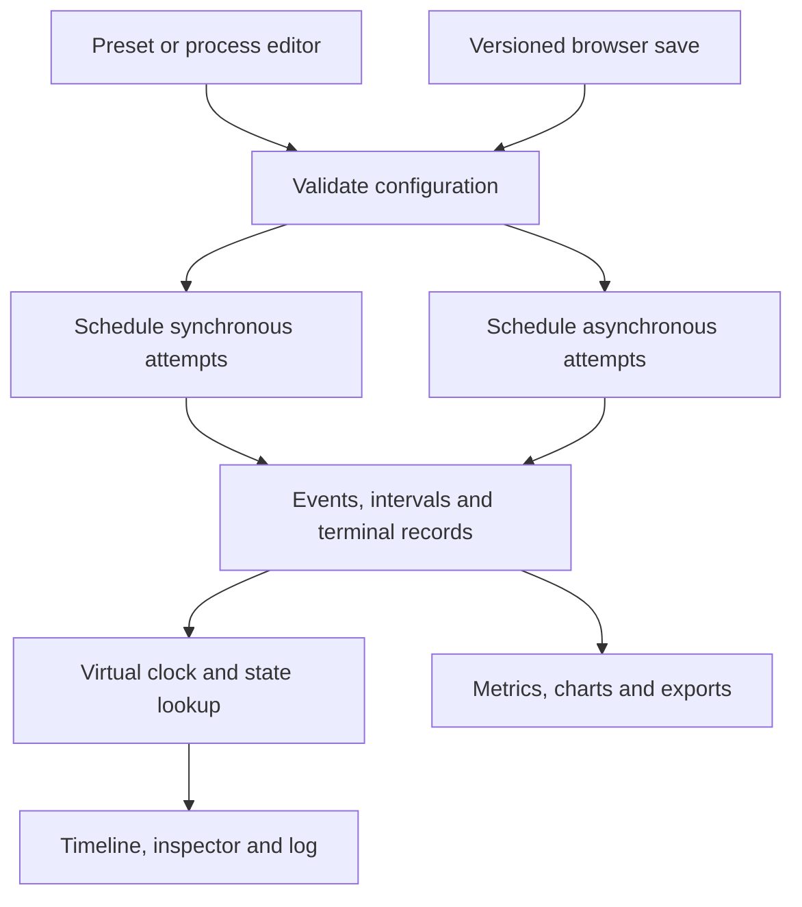

# System architecture

## Boundaries

| Module             | Inputs                                | Outputs and responsibilities                                                          |
| ------------------ | ------------------------------------- | ------------------------------------------------------------------------------------- |
| data/workloads.ts  | Preset choice or untrusted saved JSON | Validated configuration with unique process IDs, integer durations and bounded counts |
| engine/schedule.ts | Configuration and mode                | Pure schedule, logical records, occupancy edges, intervals and ordered events         |
| engine/metrics.ts  | Terminal records and peak occupancy   | Totals, means, throughput and terminal order                                          |
| hooks/playback.ts  | Sorted event times                    | Virtual cursor, run status, speed and playback actions                                |
| hooks/lifecycle.ts | Event histories and cursor            | Current status by process, using binary search over state changes                     |
| components         | Typed data and actions                | Timelines, editor, charts, inspector, guide and log                                   |
| App.tsx            | Active workload and navigation        | Coordinates the two schedules, selection, persistence and downloads                   |

## Data contracts

A process specifies identity, arrival, outbound transport, processing duration, inbound transport and failure behavior. A configuration adds concurrency, delivery mechanism, timeout, retries, overhead, backoff, polling interval and queue delay. All time inputs are integer milliseconds.

An event contains its virtual timestamp, insertion sequence, model, process ID, attempt number, event type, status and message. Attempt zero marks admission to the workload. A positive attempt number correlates a response with its dispatch, so an expired reply cannot complete a later attempt. A phase interval uses half-open endpoints. Each final process record contains arrival, first start, end, terminal outcome, response, accumulated waiting and communication, and attempt count.

## State and ownership

Each scheduler reads the same configuration independently. Editor drafts are deep copies. Applying a valid draft invalidates the old cursor and rebuilds both schedules. Saving is explicit and versioned. Invalid data leaves the active workload intact.

One requestAnimationFrame loop advances playback, scaled by the selected speed and capped by the last event time. Its cleanup cancels the pending frame on pause, speed change or unmount. Equal timestamps become one step. Scrubbing through events is independent of host performance. The learning page's real timers are separate.

## Presentation

Gantt bars use the same scale for both models. Queued stripes show admission delay, colored segments show transport and processing, and terminal markers identify the final result. Once playback starts, future phases dim. Selecting a lane opens the corresponding model. The event log pages through already reached events, while the scheduled inspector exposes the whole trace. Analytics is loaded on demand.

## Complexity

With N processes, A total attempts and E emitted events, straightforward ready-list sorting costs at most O(A N log N). The final event sort costs O(E log E), and storage is O(E + A). Polling can dominate E. The supported range is 1–20 processes, at most four attempts each, and a minimum polling interval of 25 ms. A binary-search prefix and bounded visible rows keep log rendering independent of the full event count.
